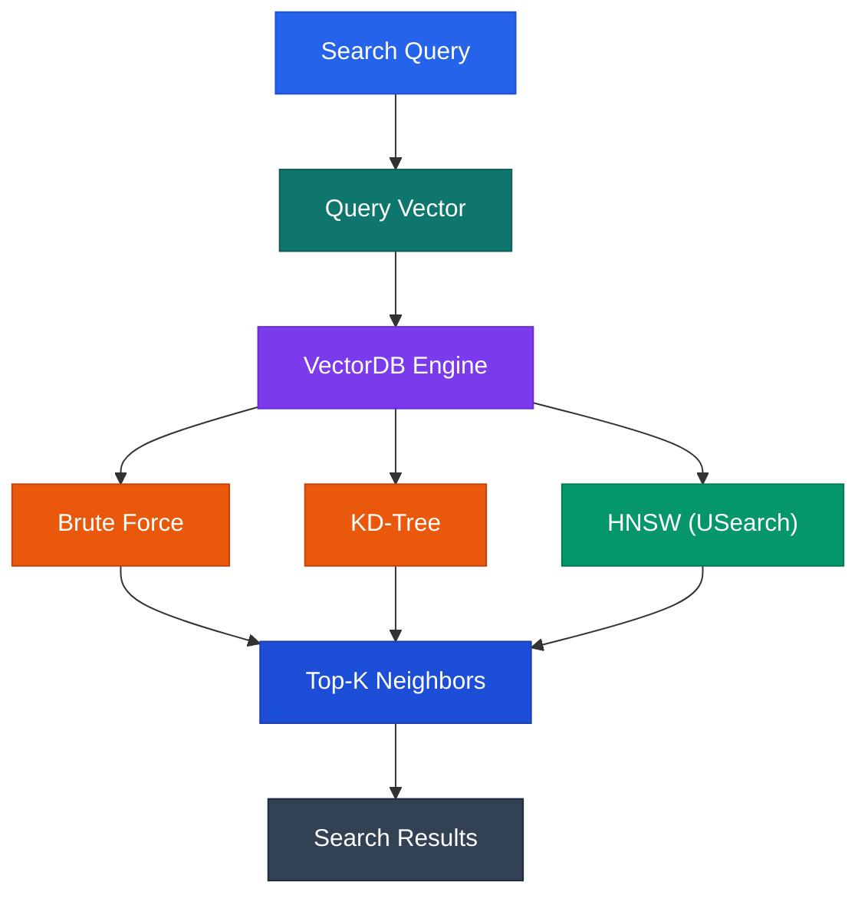

## VectorDB — Build a Vector Database from Scratch in Python

A lightweight, educational Vector Database built with Python, featuring multiple nearest-neighbor search algorithms, a web-based UI, semantic document search, and a Retrieval-Augmented Generation (RAG) pipeline powered by local LLMs through Ollama.

Explore how vector databases work under the hood by comparing HNSW, KD-Tree, and Brute Force search side by side, visualizing vector embeddings, and building a complete local RAG application.

Learn the core concepts behind vector databases such as Pinecone, Weaviate, Chroma, and Milvus — from vector indexing and similarity search to document retrieval and LLM-powered question answering.

## ✨ Features
- Multiple Search Algorithms — Compare HNSW, KD-Tree, and Brute Force nearest-neighbor search.
- USearch-Powered HNSW — Use USearch for efficient approximate nearest-neighbor indexing.
- Multiple Distance Metrics — Cosine similarity, Euclidean distance, and Manhattan distance, where supported by the implementation.
- Interactive Web UI — Search vectors, inspect results, visualize embeddings, and explore algorithm performance.
- Vector Visualization — Project high-dimensional vectors into 2D using PCA to explore semantic clusters.
- Real Document Embeddings — Convert text into dense vector representations using Ollama and nomic-embed-text.
- Document Chunking — Split long documents into smaller, overlapping chunks for more relevant retrieval.
- Local RAG Pipeline — Retrieve relevant document chunks and use a local language model to generate grounded answers.
- REST API — Integrate vector search, document ingestion, and question answering into other applications.
- Local-First Architecture — Run embeddings, retrieval, and generation locally without relying on a hosted AI API.


## 🏗️ Architecture

The project has two main workflows: vector search and document question answering.

1. Vector Search


3. Retrieval-Augmented Generation (RAG)
```mermaid
             flowchart TD
    A["Your Documents"] --> B["Text Chunking"]
    B --> C["Ollama Embedding Model<br/>nomic-embed-text"]
    C --> D["Vector Index<br/>(USearch)"]

    E["Your Question"] --> F["Embed the Question"]
    F --> G["Semantic Retrieval"]
    D --> G

    G --> H["Relevant Text Chunks"]
    H --> I["Local LLM<br/>(Ollama)"]
    E --> I
    I --> J["Final Answer"]

    style A fill:#2563eb,color:#fff,stroke:#1d4ed8
    style B fill:#0f766e,color:#fff,stroke:#115e59
    style C fill:#7c3aed,color:#fff,stroke:#6d28d9
    style D fill:#059669,color:#fff,stroke:#047857
    style E fill:#2563eb,color:#fff,stroke:#1d4ed8
    style F fill:#0f766e,color:#fff,stroke:#115e59
    style G fill:#7c3aed,color:#fff,stroke:#6d28d9
    style H fill:#1d4ed8,color:#fff,stroke:#1e40af
    style I fill:#ea580c,color:#fff,stroke:#c2410c
    style J fill:#059669,color:#fff,stroke:#047857

 ```

The embedding model converts text into numerical vectors. The vector index retrieves semantically relevant chunks, which are passed to the language model as context for generating an answer.

## 🔍 Search Algorithms

One of the main goals of this project is to demonstrate how different nearest-neighbor algorithms behave on the same dataset.

Algorithm	Search Type	Main Advantage	Main Limitation
Brute Force	Exact	Simple and reliable baseline	Scales linearly with dataset size
KD-Tree	Exact, with pruning	Effective for suitable low-dimensional data	Performance degrades in high dimensions
HNSW (USearch)	Approximate	Fast retrieval on many high-dimensional workloads	Uses additional index memory and may miss true nearest neighbors

## Brute Force Search
- Brute Force calculates the distance between the query and every stored vector, then returns the nearest results.

- Provides an exact baseline for supported distance metrics.
- Easy to understand and implement.
- Useful for validating approximate search results.
- Search cost grows with the number of vectors and their dimensionality.

## KD-Tree
- A KD-Tree recursively partitions vector space along selected dimensions. Search explores promising branches and prunes branches that cannot improve the current nearest-neighbor results.
- Can perform well on low-dimensional datasets.
- Provides exact nearest-neighbor results when implemented with correct pruning.
- May lose its advantage as dimensionality increases.
- In high-dimensional spaces, pruning often becomes less effective, and search can approach a linear scan.

## HNSW with USearch

- HNSW stands for Hierarchical Navigable Small World. It builds a multilayer proximity graph in which upper layers provide long-range navigation and lower layers enable more detailed local search.
- USearch provides an optimized implementation of this indexing approach.
- Efficient approximate nearest-neighbor retrieval.
- Well suited to many embedding-search workloads.
- Supports configurable index behavior and distance metrics, subject to the selected USearch API and configuration.
- Trades some retrieval accuracy and additional memory usage for speed.
- Actual performance depends on dataset size, dimensionality, index parameters, hardware, and query distribution.

# Important: HNSW is an approximate search algorithm. Use Brute Force as a reference when evaluating recall and retrieval quality.

## 📐 Distance Metrics

Distance metrics determine how the similarity between two vectors is measured.

- Cosine Similarity
- Euclidean Distance
- Manhattan Distance

## 📊 Vector Visualization

The web interface includes a 2D visualization of vector space using Principal Component Analysis (PCA), if enabled in your implementation.

PCA reduces high-dimensional vectors to two principal components while retaining as much variance as possible in the projected data.

The visualization can help you explore:

How related concepts form clusters.
How different categories are distributed in vector space.
Where a query sits relative to stored vectors.
Which vectors are returned by a nearest-neighbor search.

Note: A 2D PCA projection is only a visual approximation of the original space. Points that look close on the chart are not necessarily the nearest neighbors in the full-dimensional space.

## 🤖 Local AI with Ollama

This project can use Ollama to run embedding and language models locally.

# Embedding Model
- nomic-embed-text converts text into dense vector embeddings for semantic search.

# Generation Model
- llama3.2 generates responses using the document chunks retrieved by the RAG pipeline.

The embedding model and generation model serve different purposes:

# Component	Responsibility
nomic-embed-text	Converts documents and questions into vectors
USearch / HNSW	Finds the nearest stored vectors
Retrieval pipeline	Selects relevant document chunks
llama3.2	Generates a response using retrieved context

The embedding dimensionality depends on the selected model and configuration. For the standard nomic-embed-text setup, embeddings are typically 768-dimensional.

## 📚 RAG Pipeline

Retrieval-Augmented Generation combines semantic search with text generation. Instead of asking an LLM to answer using only its pretrained knowledge, the application retrieves relevant information from your own documents and supplies it as context.

How It Works
Ingest: Provide a document or paste text into the application.
Chunk: Split long text into smaller, overlapping chunks.
Embed: Generate an embedding for each chunk.
Index: Store each embedding alongside its text and metadata.
Retrieve: Embed the user's question and find the nearest chunks.
Generate: Send the question and retrieved context to the local language model.
Respond: Display the generated answer and, where supported, the retrieved context.
Example

Suppose you insert notes about dynamic programming and ask:

What is dynamic programming, and when should it be used?

The system embeds the question, searches the document index, retrieves relevant passages, and provides those passages to the LLM as context.

The quality of the answer depends on document quality, chunking, embedding quality, retrieval settings, and the language model.

Grounding note: Providing retrieved context does not guarantee that an LLM will only use that context. For more reliable answers, instruct the model to acknowledge missing information and inspect the retrieved passages or citations.

## ⚙️ Prerequisites

Install the following software before running the project.

Python 3.12+ — Adjust this version to match your project's actual requirements.
Git — To clone the repository.
Ollama — Required for local embeddings and RAG generation.
Required Python packages — Installed from the project's requirements.txt or pyproject.toml, if provided.

USearch supports multiple operating systems and installation methods. Follow its official installation instructions if a platform-specific dependency issue occurs.

## 🚀 Getting Started

# Step 1 — Clone the Repository
bash
git clone https://github.com/mrankit360/vector-forge.git

cd vector-forge


# Step 2 — Create a Virtual Environment

command prompt

python -m venv .venv

.\.venv\Scripts\Activate.ps1

Linux / macOS

bash

python3 -m venv .venv

source .venv/bin/activate


If PowerShell prevents virtual-environment activation, use the appropriate execution-policy guidance for your environment or run the activation script from Command Prompt instead.

# Step 3 — Install Dependencies

bash

python -m pip install --upgrade pip

pip install -r requirements.txt

# Step 4 — Install Ollama and Download Models

# Download Ollama from ollama.com.

# Pull the embedding model:

bash

ollama pull nomic-embed-text


# Pull the generation model:

bash

ollama pull llama3.2


# Check the installed models:

bash

ollama list


# Ollama generally runs as a background service after installation. If it is not running, start it with:

bash

ollama serve


Avoid starting a second server if Ollama is already running.

Step 5 — Start the Application

Run the entry point used by your project. For example, if the application entry point is main.py:

bash

python main.py


Open the local URL printed by the application in your browser.


## 🖥️ Using the Application

The following sections describe the intended workflow. Rename the tabs or controls to match the actual UI.

# Vector Search

Enter a query or select a sample vector.

Choose the search algorithm: HNSW, KD-Tree, or Brute Force.

Select the distance metric supported by the application.

Choose the number of nearest neighbors, 
𝑘
.

# Run the search and inspect the results.

Compare latency and result quality across algorithms.

# Document Ingestion

Enter a document title.

Paste or upload supported text.

# Submit the document for processing.

Allow the application to split the document into chunks and generate embeddings.

Confirm that the document has been indexed.

# Ask AI
- Ingest at least one document.
- Enter a question about the stored content.
- Submit the question to the RAG pipeline.
- Inspect the generated response.
- Review the retrieved chunks, if the UI exposes them.
- 
## 🌐 REST API

An example API reference for a project with equivalent functionality might look like this:

Method	Endpoint	Purpose

 GET / — Serves the web UI (index.html).

GET /search — Searches demo vectors using HNSW, KD-Tree, or Brute Force.

POST /insert — Inserts a new demo vector.

DELETE /delete/{item_id} — Deletes a demo vector by ID.

GET /items — Lists all demo vectors.

GET /benchmark — Benchmarks the three search algorithms.

GET /hnsw-info — Returns HNSW-related metadata; actual graph details are unavailable.

GET /stats — Returns database statistics, dimensions, algorithms, and metrics.

POST /doc/insert — Chunks, embeds, and stores a document using Ollama.

DELETE /doc/delete/{item_id} — Deletes a document chunk by ID.

GET /doc/list — Lists stored document chunks with previews and word counts.

POST /doc/search — Retrieves relevant document chunks using semantic search.

POST /doc/ask — Runs the RAG pipeline and generates an AI answer using Ollama.

GET /status — Checks Ollama availability, model information, and database statistics.


## 📈 Benchmarking and Evaluation

Comparing algorithms is more meaningful when performance and accuracy are measured separately.

 Useful measurements include:

 - Query latency: Time taken to retrieve the nearest neighbors.
 - Throughput: Number of queries processed per second.
 - Recall: Fraction of the exact top-
𝑘
 - neighbors also found by approximate search.
 - Index build time: Time required to construct the index.
 - Memory usage: Memory consumed by vectors and index structures.
 - Dataset size: Number of vectors and their dimensionality.
 
 # Suggested Benchmark Methodology
 - Generate or load the same dataset for each algorithm.
 - Use the same query vectors, 
𝑘
, and compatible distance metric.


The directory and file names above are illustrative. Keep only the files and modules that exist in your repository.

## 🧩 Technology Stack
# Technology	Role
- Python	Core application and orchestration
- USearch	HNSW-based vector indexing
- KD-Tree	Spatial partitioning for nearest-neighbor search
- NumPy or equivalent	Numerical vector operations, if used
- Ollama	Local embedding and text generation
- nomic-embed-text	Text embedding model
- llama3.2	Example local generation model
- PCA	Dimensionality reduction for visualization, if implemented
- Web framework	UI/API serving: HTML, CSS, Javascript
- 

## 🔐 Privacy and Limitations
- Local inference can keep document processing on your machine when all configured services run locally.
- This does not automatically guarantee that the application never sends data elsewhere; verify network calls and integrations.
- HNSW is approximate, so it may not return the exact nearest neighbors.
- PCA visualizations can distort high-dimensional relationships.
- RAG responses can contain incorrect or unsupported claims.
- Persistence, concurrency, authentication, access control, and production deployment depend on the actual implementation.

This project is intended primarily for learning and experimentation. Do not assume production-grade durability, security, or scalability without additional testing.


## 🤝 Contributing

Contributions, bug reports, and suggestions are welcome.

- Fork the repository.
- Create a feature branch.
- Make your changes and add tests where appropriate.
- Submit a pull request describing the changes.

Please include reproducible steps for bug reports and benchmark details for performance-related changes.

## 📄 License

This project is distributed under the MIT License if the repository includes that license. See the LICENSE file for the applicable terms.

## ⭐ Support the Project

If you find this project useful for learning vector databases, semantic search, or RAG systems, consider giving the repository a star.

Built to explore the internals of vector search — one embedding at a time.
